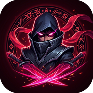

<div align="center">



# 血契竞技场 · Pact Arena

**快节奏暗黑霓虹波次肉鸽动作手游（Android / Windows）**

[](https://godotengine.org/)
[](https://github.com/Muuurain/pact-arena/releases)
[](https://github.com/Muuurain/pact-arena/actions/workflows/ci.yml)
[](LICENSE)

> **6 武器环绕合成 × 三神系流派共鸣 × 赌命血契祭坛 × 深渊圣所局外成长**

</div>

---

## 游戏简介

**《血契竞技场》（Pact Arena）** 是一款专为手机端碎片化游玩打造的竖屏快节奏竞技场肉鸽（Roguelite）动作游戏。在保留经典《土豆兄弟》式**多武器环绕自动开火 + 正负属性权衡 + 波间商店构筑**爽感的同时，融入了**三神系双融合共鸣**、**偶数波赌命血契祭坛**、**四阶红武双形态觉醒**以及完整的**深渊圣所局外成长**。

单波战斗仅需 **26~48 秒**，支持任意时刻在波间整备期自动存档，随时拿起随时开打！

---

## 核心特色

- **单手竖屏 × 血步破防机制（v2.0 冷却倒计时可视化）**
  - 移动端全屏自适应浮动虚拟摇杆 + 右下角大尺寸拇指**血步瞬移技能盘（2 层充能）**；实时显示精确到 `0.1s` 的冷却倒计时秒数、底部扫光填充条与充能就绪弹跳反馈；桌面端支持 `WASD`/方向键 + `Space`/`Shift`。
  - 血步穿过敌人可挂上 **3.5 秒「破甲印记」（+35% 易伤）** 并**立即重置全部已装备近战武器冷却**，高风险穿怪带来高回报爆发。
- **现代暗黑霓虹美术 & 多维动态动画（v2.0 重构）**
  - 全套英雄、敌怪、Boss、14 把武器、掉落物、地面瓷砖及主界面 Key Art 均基于 **Nano Banana** 图像生成并配合无溢色抠图流水线制作。
  - 主角/敌怪/Boss 具备待机呼吸、跑步动态倾斜弹跳、受击挤压拉伸、Boss 旋转法阵与脚底投影；近战武器支持弧线大幅挥砍、长矛突刺与枪械后坐力枪口闪光。
- **6 位机制迥异的英雄**
  - **血刃游侠**、**苍蓝魔导**、**狂战屠夫**、**独臂修罗**、**契约守财奴**、**虚空织命者**（支持局内硬核挑战解锁，或消耗深渊余烬提前解禁）。
- **14 把武器 × 4 阶品质 × 28 条觉醒路线**
  - 涵盖近战挥砍、重劈震地、突刺、回旋飞镰、连锁电弧、冰霜散射、激光束、弹射离子球、追踪骨矛、浮游魔典、黑洞迫击炮与自走哨戒炮台。
  - 两把 3 阶紫武合成 4 阶红武时，触发**二选一质变觉醒形态**。
- **三神系羁绊与双神融合共鸣**
  - **猩红（2/4/6）**：暴击、流血、生命偷取、血狂攻速叠层。
  - **苍蓝（2/4/6）**：攻速、射程、弹射穿透、冰缓控制、高频超导落雷。
  - **虚空（2/4/6）**：元素/召唤强化、诅咒易伤、击杀虚空爆裂、低血斩杀。
  - **跨系双神共鸣**：【血雷风暴】（猩红2+苍蓝2）、【嗜魂诅咒】（猩红2+虚空2）、【虚空磁暴】（苍蓝2+虚空2）。
- **10 种赌命「血契祭坛」契约 + 18 种正负权衡道具**
  - 偶数波开启血契祭坛，在极高代价与逆天收益间抉择：如 *玻璃大炮之誓*（血量上限锁死 20 换 1.55 倍全伤与额外利息）、*毒血炼金契*（禁用回血并将治疗量 220% 转为周围毒爆）等。
- **双阶段机制 Boss 与无尽深渊（v2.2.0 韧性护盾与防秒杀重塑）**
  - 第 5 波《赤潮审判官》（6,200 基础血量）与第 10 波《深渊双生主宰》（28,000 基础血量）具备入场护盾与高难韧性减伤机制（可通过「血步瞬移」的破甲印记穿透）；击败第 10 波后可选择**荣耀撤离**或**踏入第 11+ 波无尽深渊**冲榜。
- **6 阶难度分级 + 黑市淬炼 + 完整局外成长**
  - **深渊难度分级（D0 ~ D5，v2.2.0 新增）**：`D0 试炼` 至 `D5 深渊终焉` 全面阶梯调节敌方生命（最高 `3.10×`）、伤害（最高 `2.05×`）、移速、密度、物价、Boss 精英侍卫与波间免费回血比例，最高额外提供 **+190%** 深渊余烬奖励。
  - **深渊黑市淬炼（v2.2.0 新增）**：商店底部新增三大可无限递增消耗血晶的淬炼槽位（武器淬炼、鲜血铸体、随机遗物盲盒），解决大后期血晶溢出。
  - **深渊圣所**：战备 / 生存 / 贪婪三大分支共 12 项多级天赋，支持**免费 100% 一键洗点**。
  - **武器精通与流派禁用**：武器击杀累计升至 Lv.1~5 级，Lv.2 起开放全英雄通用开局携带；支持禁用不喜欢的商店道具/武器。
  - **深渊热度（Heat 0~8）**：可与 `D0~D5` 难度自由叠加，每条高难词缀额外提供 +25% 余烬结算收益。

---

## 技术架构与目录结构

项目采用 **Godot 4.7.2 + 强类型 GDScript 2.0 + GL Compatibility (OpenGL ES 3.0)** 构建，全套美术与音频资产均通过工程内 Python + FFmpeg 脚本离线程序化生成，无外部版权依赖。

```text
pact_arena/
├── assets/
│   ├── art/                 # 73 张超采样透明精灵（角色/敌怪/Boss/武器/18种道具/黑市图标/地面瓷砖与UI）
│   ├── audio/               # 27 个战斗/UI 音效与 3 首无缝循环 BGM (.ogg)
│   └── shaders/             # 受击闪白、Boss 地面预警圈、危险暗角着色器
├── docs/
│   ├── GAME_DESIGN.md       # 完整数值公式、武器、血契与局外成长设计文档
│   └── ARCHITECTURE.md      # 分层架构、数据流与移动端性能优化说明
├── src/
│   ├── autoload/            # EventBus / GameData / SaveManager / AudioManager
│   ├── core/                # 纯逻辑数值引擎 (StatBlock / CombatFormulas / SynergyEngine / RunState)
│   ├── combat/              # 空间哈希敌群 / 池化弹幕与拾取 / 6 武器环绕 / 玩家血步 / 波次导演
│   ├── ui/                  # 适配 Safe Area 的响应式竖屏 UI 与全屏浮动虚拟摇杆
│   ├── scenes/              # Main.tscn & Arena.tscn
│   └── Main.gd              # 全局状态与界面流转调度器
├── tests/                   # 无头自动化测试与主场景冒烟测试 (TestSuite.gd)
├── tools/                   # 离线美术/音频生成脚本与一键验证打包脚本
├── project.godot
└── export_presets.cfg
```

更多细节请参阅 [游戏设计文档](docs/GAME_DESIGN.md) 与 [技术架构文档](docs/ARCHITECTURE.md)。

---

## 快速开始与构建

### 1. 直接试玩
- **Android 手机端**：前往本仓库 [Releases](https://github.com/Muuurain/pact-arena/releases) 下载最新 `pact_arena_debug.apk` 安装游玩，或通过 ADB 安装：
  ```bash
  adb install -r pact_arena_debug.apk
  ```
- **源码运行**：使用 **Godot 4.7.2** 打开根目录 `project.godot` 直接点击运行（`F5`）。

### 2. 运行自动化测试与导出
```powershell
# 运行全部无头单元测试与主场景 Boss 冒烟测试
powershell -ExecutionPolicy Bypass -File tools\verify_project.ps1

# 测试并同时导出 Android APK 与 Windows 测试版
powershell -ExecutionPolicy Bypass -File tools\verify_project.ps1 -ExportAndroid -ExportWindows
```

### 3. 重新生成/处理离线美术与音频资产（可选）
需要 Python 3.11+（`Pillow`、`numpy`）以及 `ffmpeg`：
```bash
python tools/process_nano_assets.py   # 处理 Nano Banana 生成图集并导出透明精灵
python tools/generate_audio.py        # 重新合成 OGG 音效与循环 BGM
```

---

## 操控说明

| 平台 | 移动 | 血步瞬移（穿怪破甲 + 重置近战冷却） | 界面交互 |
| :--- | :--- | :--- | :--- |
| **Android 手机** | 屏幕任意区域按住拖动（浮动虚拟摇杆） | 点击右下角「血步」按钮 | 单指点按购买 / 融合 / 选血契 |
| **Windows 桌面** | `W A S D` / 方向键（或鼠标左键拖拽模拟摇杆） | `Space` / `Shift`（或点击按钮） | 鼠标左键点击 |

---

## 开源协议

本项目基于 [MIT License](LICENSE) 开源。
